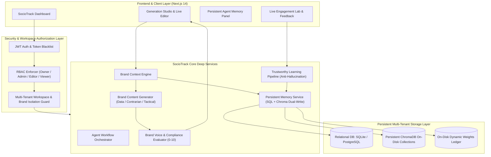

# SocioTrack: Autonomous AI Social Media Intelligence & Persistent Memory Engine

> **Live Application**: [https://frontend-taupe-zeta-84.vercel.app/](https://frontend-taupe-zeta-84.vercel.app/)  
> **Repository**: [https://github.com/stillzepta/sociotrack](https://github.com/stillzepta/sociotrack)  
> **API Swagger Docs**: [http://localhost:8000/docs](http://localhost:8000/docs) • **Local Next.js App**: [http://localhost:3000](http://localhost:3000)

---

## 🌟 Overview

**SocioTrack** is an enterprise-grade, closed-loop autonomous AI social media intelligence and content generation platform. While conventional social media schedulers treat every generation request as an isolated blank slate—producing generic marketing platitudes and hallucinated statistics—SocioTrack establishes **persistent, multi-tenant memory** of brand voice, target audiences, and verified performance insights across sessions.

By transforming empirical post engagement metrics (impressions, shares, replies, likes, Meta Developer Webhooks) into durable strategic guidance, SocioTrack continuously recalibrates brand memory weights, optimizes hook archetypes, and guarantees strict multi-tenant workspace isolation.

### Key Architectural Highlights
- **Persistent ChromaDB Vector Engine**: Native on-disk vector storage (`chromadb.PersistentClient`) partitioned by workspace and brand slug (`w_{ws}_b_{bid}_{type}`). Vector embeddings, strategic lessons, and dynamic weights survive complete application restarts.
- **Relational Dual-Write Durability**: Synchronized SQLite / PostgreSQL schema (`agent_memories`, `brands`, `workspaces`, `posts`, `post_analytics`) enforcing relational foreign-key integrity, multi-tenant RBAC, and audit trails.
- **Genuine Model-Powered AI**: Direct multi-provider LLM integrations (LangChain ChatOpenAI, Groq, Google Gemini) enforcing a **Zero-Fabrication Invariant**: the engine never hallucinates unverified statistical claims, customer testimonials, or case studies.
- **Trustworthy Learning Pipeline**: Single-rejection guard ensures an isolated rejection never creates a permanent negative rule (requires $\ge 2$ recurring observations or explicit user guidance); simulated telemetry is strictly blocked from forming strategic memory.
- **Strict Multi-Tenant RBAC & Security**: Full workspace data isolation, role-based access control (`owner`, `admin`, `editor`, `viewer`), password complexity, JWT revocation with token blacklisting, and HMAC-SHA256 webhook verification.
- **Modern Monochromatic Frontend**: Next.js 14 App Router UI adhering to a high-contrast black-and-white design system with light/dark modes, real-time draft editor, cognitive memory inspection panel, and interactive engagement lab.

---

## 🏗️ System Architecture



---

## 🔒 Security Foundation & Multi-Tenant RBAC (Steps 1–3)

SocioTrack incorporates a zero-trust multi-tenant architecture hardened across Steps 1 through 3:

1. **Workspace Data Isolation**: Every brand, post, draft, memory rule, and analytics event is bound to a `workspace_id`. Cross-workspace access attempts are intercepted and return `HTTP 403 Forbidden` or `HTTP 404 Not Found`.
2. **Role-Based Access Control (RBAC)**:
   - **`owner`**: Full workspace control, team invitations, member role updates, workspace deletion.
   - **`admin`**: Brand creation, settings modification, API key management.
   - **`editor`**: Draft generation, content approval, post scheduling, memory rule adjustments.
   - **`viewer`**: Read-only access to analytics, calendar, and generated drafts.
3. **Authentication & Session Hardening**:
   - Passwords hashed using standard **Bcrypt** with salt and complexity enforcement (length $\ge 8$, mixed case, digits, special characters).
   - JWT tokens signed with deterministic algorithms (`HS256`), containing verified `sub`, `workspace_id`, and `exp` claims.
   - Token blacklisting and session revocation on `/api/auth/logout` and `/api/auth/change-password`.
   - Production startup assertions: startup fails immediately if `SECRET_KEY` is missing or uses insecure default values, if `DEBUG=True` in production, or if `CORS_ORIGINS` contains wildcards.
4. **Webhook Cryptographic Verification**:
   - **Meta / Instagram Webhooks**: Validates `X-Hub-Signature-256` HMAC-SHA256 digest against `META_APP_SECRET`.
   - **Stripe Webhooks**: Validates `Stripe-Signature` against `STRIPE_WEBHOOK_SECRET` before processing invoice and subscription lifecycle events.
5. **Privacy & Data Governance**: Full GDPR/CCPA compliance via `/api/user/privacy/export` (structured data dump) and `/api/user/privacy/delete` (hard deletion).

---

## 🧠 Genuine AI Intelligence & Brand Generation (Step 4)

SocioTrack's AI generation pipeline uses genuine large language model calls via LangChain with zero simulated outputs:

- **Zero-Fabrication Invariant**: Prompts strictly prohibit the LLM from inventing fake customer case studies, unverified statistics, or synthetic performance metrics. Any illustrative figures must be framed as industry heuristics or prompts for reader data.
- **Multi-Angle Variations**: Every generation cycle produces 3 distinct creative angles:
  1. **Data-First**: Analytical, metric-driven, structured for high dwell time.
  2. **Contrarian / Hot Take**: Challenges prevailing dogma with practitioner reasoning.
  3. **Tactical Breakdown**: Step-by-step actionable guide or framework.
- **Platform-Native Formatting**: Tailored structure for LinkedIn (concise hooks, scannable whitespace), Instagram (clean line breaks, targeted tags), and X/Twitter (punchy character constraints).
- **Automated Voice Evaluation**: Generated drafts are automatically scored against the brand archetype ($0.0 - 10.0$) with structured critique across voice alignment, clarity, audience fit, and anti-patterns.

---

## 💾 Persistent Memory & Continuous Learning (Step 5)

SocioTrack features a trustworthy learning pipeline that turns real human interactions into persistent institutional memory:

### 1. Dual-Store Persistence Engine
- **ChromaDB `PersistentClient`**: Replaces ephemeral in-memory vector stores. Embedded vector records reside in `{CHROMA_PERSIST_DIRECTORY}` and survive full application reboots.
- **Multi-Tenant Partitioning**: Chroma collections and dynamic weight JSON files are segmented by workspace and brand slugs:
  - `w_{clean_ws}_b_{clean_bid}_posts`: High-performing past posts and hooks.
  - `w_{clean_ws}_b_{clean_bid}_sentiment`: Audience reaction signals and topics.
  - `w_{clean_ws}_b_{clean_bid}_lessons`: Strategic rules, dos, and donts.
  - `{tenant_key}_weights.json`: Dynamic topic and format multipliers.
- **Brand Collision Immunity**: Distinct workspaces with identically named brands (e.g. `"Apex Engineering"`) maintain independent vector spaces with zero cross-talk.

### 2. Structured Memory Categories
- `brand_identity`: Core voice guidelines, tone boundaries, and target personas.
- `content_preferences`: Positive stylistic rules, winning structures, and vocabulary dos.
- `donts_avoided`: Negative guidelines synthesized from recurring rejections or explicit prohibitions.
- `feedback_and_learning`: Insights distilled from human post edits and review decisions.
- `performance_insights`: Empirical takeaways extracted from multi-post verified analytics.

### 3. Trustworthy Learning Invariants
- **Single Rejection Guard**: A single, isolated rejection does **not** create a permanent negative rule. Only recurring rejections ($\ge 2$ times with the same reason) or explicit user instructions trigger rule synthesis.
- **Protection Against Simulated Data**: Telemetry originating from simulators or sample sizes $< 3$ posts is strictly barred from forming permanent strategic memory.
- **Conflict Resolution**: When an explicit user directive is added, older conflicting inferred rules in the same category are automatically superseded.

---

## 📁 Repository Structure

```
SocioTrack/
├── .env.example                               # Centralized template for secrets & storage paths
├── .gitignore
├── README.md                                  # Repository documentation & architecture guide
│
├── backend/                                   # FastAPI Backend, LangGraph & Persistent Memory
│   ├── app/
│   │   ├── main.py                            # FastAPI application entry point, CORS, routers
│   │   ├── config.py                          # Pydantic Settings (ENV validation & production guards)
│   │   ├── database.py                        # SQLAlchemy async engine, sessionmaker, schema migrations
│   │   ├── core/
│   │   │   ├── agent.py                       # LangGraph StateGraph (Person 1 core engine)
│   │   │   ├── memory.py                      # VectorMemoryManager (ChromaDB PersistentClient)
│   │   │   ├── diagnostics_agent.py           # Creator audit & anomaly detection math
│   │   │   └── security.py                    # Bcrypt hashing, JWT creation/validation, blacklisting
│   │   ├── models/                            # SQLAlchemy ORM Models
│   │   │   ├── user.py                        # Users & session tokens
│   │   │   ├── workspace.py                   # Workspaces, memberships (RBAC), invites, API keys
│   │   │   ├── brand.py                       # Brands, target audience, voice archetypes
│   │   │   ├── post.py                        # Posts lifecycle (draft, scheduled, published)
│   │   │   ├── memory.py                      # AgentMemory (SQL relational memory store)
│   │   │   ├── feedback.py                    # User feedback & rejection records
│   │   │   ├── analytics.py                   # Post analytics & engagement metrics
│   │   │   ├── billing.py                     # Stripe subscriptions, invoices, usage meters
│   │   │   └── experiment.py                  # Content A/B test experiments & variants
│   │   ├── schemas/                           # Pydantic request/response schemas
│   │   │   ├── auth.py, brand_schema.py, post_schema.py, memory.py, feedback.py, workspace.py
│   │   ├── services/                          # Deep Domain Services
│   │   │   ├── persistent_memory_service.py   # SQL + Chroma dual-write, deduplication, conflict resolution
│   │   │   ├── brand_context_engine.py        # Brand context retrieval, prompt formatting, token budgeting
│   │   │   ├── brand_content_generator.py     # Genuine multi-model LLM draft generator
│   │   │   ├── brand_voice_evaluator.py       # Automated voice compliance evaluator (0-10)
│   │   │   ├── ai_provider_service.py         # Multi-provider client wrapper (OpenAI, Groq, Gemini)
│   │   │   ├── agent_workflow.py              # LangGraph multi-node workflow orchestrator
│   │   │   ├── billing_service.py             # Stripe checkout, subscription & webhook handler
│   │   │   └── workspace_service.py           # Team membership, invites & RBAC validation
│   │   └── routers/                           # FastAPI Router Endpoints (20+ sealed routers)
│   │       ├── auth.py, workspaces.py, brands.py, drafts.py, posts.py, memory.py,
│   │       ├── feedback.py, calendar.py, experiments.py, billing.py, webhooks.py,
│   │       └── product_analytics.py, user_privacy.py, diagnostics.py, simulator.py
│   ├── tests/                                 # 154 Pytest Test Suites
│   │   ├── test_security_foundation.py        # Step 1: Endpoint protection & ownership verification
│   │   ├── test_workspace_isolation_and_rbac.py # Step 2: Multi-tenant isolation & RBAC enforcement
│   │   ├── test_auth_and_production_hardening.py # Step 3: Auth, JWT claims, and startup guards
│   │   ├── test_step4_genuine_ai_and_brand_generation.py # Step 4: Real model generation & schemas
│   │   ├── test_step5_persistent_memory_and_learning.py # Step 5: Chroma persistence & learning pipeline
│   │   ├── test_agent.py                      # Person 1 LangGraph agent cycle benchmark
│   │   ├── test_billing_and_usage_metering.py # Stripe billing & usage tracking
│   │   └── test_webhooks.py                   # HMAC signature verification tests
│   ├── requirements.txt
│   └── Dockerfile
│
└── frontend/                                  # Next.js 14 App Router (Monochromatic UI)
    ├── src/
    │   ├── app/
    │   │   ├── layout.tsx, page.tsx, globals.css
    │   ├── components/
    │   │   ├── auth/AuthPage.tsx              # Split-screen login, signup, password reset
    │   │   ├── GenerationStudio.tsx           # Multi-platform draft studio with live preview
    │   │   ├── DraftCard.tsx                  # Editable post card, engagement gauge, explainability
    │   │   ├── AgentMemoryPanel.tsx           # Category-filtered persistent memory management
    │   │   ├── LiveEngagementLab.tsx          # Real-time metric simulator & 5-step feedback loop
    │   │   ├── InsTrackSaaSDashboard.tsx      # Creator analytics, follower snapshots & competitor intel
    │   │   ├── InsTrackCalendarView.tsx       # Content schedule & editorial queue
    │   │   ├── CustomerBillingPortal.tsx      # Stripe subscription tier selector & usage cards
    │   │   ├── TeamCollaborationModal.tsx     # Workspace team invites & member role editor
    │   │   └── ExtraViews.tsx                 # Extra dashboard tabs & sub-views
    │   ├── lib/api.ts                         # Authenticated fetch wrapper with Bearer token injection
    │   └── mocks/mockData.ts                  # Type-safe fallbacks
    ├── package.json
    ├── tailwind.config.js
    └── tsconfig.json
```

---

## ⚡ Quickstart & Local Setup

### Prerequisites
- **Python**: 3.9+ (Python 3.9 – 3.12 supported)
- **Node.js**: 18+ (Node 20 LTS recommended)
- **Git**

### 1. Backend Setup

```bash
# Clone the repository
git clone https://github.com/stillzepta/sociotrack.git
cd sociotrack

# Create and activate virtual environment
python3 -m venv .venv
source .venv/bin/activate

# Install dependencies
pip install -r backend/requirements.txt

# Configure environment variables
cp .env.example .env
# Edit .env to set SECRET_KEY, VECTOR_STORE_PROVIDER=chroma, CHROMA_PERSIST_DIRECTORY=./chroma_data

# Run database migrations and seed data
python3 backend/db/seed.py

# Start the FastAPI backend
uvicorn backend.app.main:app --reload --host 0.0.0.0 --port 8000
```
- Interactive Swagger API Documentation: `http://localhost:8000/docs`
- Storage Health Status: `http://localhost:8000/api/memory/status`

### 2. Frontend Setup

```bash
cd frontend

# Install dependencies
npm install

# Start Next.js development server
npm run dev
```
- Interactive Dashboard: `http://localhost:3000`

---

## 🧪 Comprehensive Automated Testing

SocioTrack includes a comprehensive automated test suite verifying security, multi-tenant isolation, authentic model invocation, persistent ChromaDB memory, and sub-second agent benchmarks.

### Run All Backend Tests (154 Tests)

```bash
PYTHONPATH=backend pytest backend/tests/ -v
```

```
============================== 153 passed, 1 skipped in 38.55s ==============================
```

### Run Dedicated Step-by-Step Test Suites

```bash
# Step 1: Security Foundation & Endpoint Sealing
PYTHONPATH=backend pytest backend/tests/test_security_foundation.py -v

# Step 2: Multi-Tenant Workspace Isolation & RBAC
PYTHONPATH=backend pytest backend/tests/test_workspace_isolation_and_rbac.py -v

# Step 3: Auth & Production Configuration Hardening
PYTHONPATH=backend pytest backend/tests/test_auth_and_production_hardening.py -v

# Step 4: Genuine AI Intelligence & Brand Generation
PYTHONPATH=backend pytest backend/tests/test_step4_genuine_ai_and_brand_generation.py -v

# Step 5: Persistent Memory & Continuous Learning
PYTHONPATH=backend pytest backend/tests/test_step5_persistent_memory_and_learning.py -v
```

### Run Agent Performance Benchmark

```bash
PYTHONPATH=backend python3 backend/tests/test_agent.py
```
```
[Benchmark] run_agent_cycle Latency: 111.56 ms (< 6000 ms)
[Benchmark] ingest_analytics (High Score) Latency: 107.57 ms (< 6000 ms)
[Benchmark] ingest_analytics (Low Score) Latency: 0.22 ms (< 6000 ms)
----------------------------------------------------------------------
Ran 7 tests in 1.229s
OK
```

### Run Frontend Static Production Build

```bash
cd frontend
npm run build
```
```
 ✓ Compiled successfully
   Linting and checking validity of types     ✓
   Generating static pages (4/4)              ✓
```

---

## 📡 Core API Reference

| Category | Method | Endpoint | Description |
|---|---|---|---|
| **Auth** | `POST` | `/api/auth/register` | Register new user account with password complexity check |
| | `POST` | `/api/auth/login` | Authenticate user, return JWT with active workspace ID |
| | `POST` | `/api/auth/logout` | Revoke active JWT session and blacklist token |
| | `POST` | `/api/auth/change-password` | Update password and invalidate previous sessions |
| **Workspaces** | `GET` | `/api/workspaces` | List authorized workspaces for the current user |
| | `POST` | `/api/workspaces` | Create new tenant workspace (caller becomes owner) |
| | `POST` | `/api/workspaces/{id}/invite` | Invite team member with role (`admin`, `editor`, `viewer`) |
| **Brands** | `GET` | `/api/brands` | List brands scoped to active workspace |
| | `POST` | `/api/brands` | Create new brand identity with voice archetype |
| **Generation** | `POST` | `/api/generate-drafts` | Generate 3 model-powered variations with memory context |
| | `POST` | `/api/posts/approve` | Approve, edit, or schedule draft for publishing |
| | `GET` | `/api/posts/queue` | View chronological publishing queue |
| **Memory** | `GET` | `/api/memory/status` | Genuine persistence diagnostics & storage health |
| | `GET` | `/api/brands/{id}/memory` | Retrieve brand memories, dos, and donts |
| | `POST` | `/api/brands/{id}/memory` | Record explicit brand guideline directive |
| | `PUT` | `/api/memory/{id}` | Edit or toggle active status of a memory |
| | `DELETE` | `/api/memory/{id}` | Soft-deactivate or hard-delete memory |
| | `POST` | `/api/memory/clear` | Clear all memories for a brand across SQL & Chroma |
| **Feedback** | `POST` | `/api/recommendations/feedback` | Record user feedback; trigger learning on recurring pattern |
| **Billing** | `POST` | `/api/billing/create-checkout-session` | Initialize Stripe checkout for subscription upgrade |
| | `POST` | `/api/billing/portal` | Access Stripe customer billing portal |
| **Webhooks** | `POST` | `/api/webhooks/instagram` | Verified Meta/Instagram webhook event receiver |
| | `POST` | `/api/webhooks/stripe` | Verified Stripe subscription webhook receiver |

---

## 👥 Contributors & Attribution

- **Krishna Verma (`stillzepta`)** — *Core Architecture, Creator Audits & SaaS Infrastructure*
- **XiaoArnav (`XiaoArnav`)** — *Persistent Memory, Multi-Tenant Security, Genuine AI Engine & Production Hardening*
- **Shreya R (`shreyaaa991-png`)** — *Frontend Architecture, Design System & Interactive SaaS UI*
- **Keerthana (`keerthanakeerz077`)** — *Data Engineering, Docker Orchestration & Evaluation Datasets*

---

## 📄 License

This project is licensed under the MIT License — see the [LICENSE](LICENSE) file for details.
