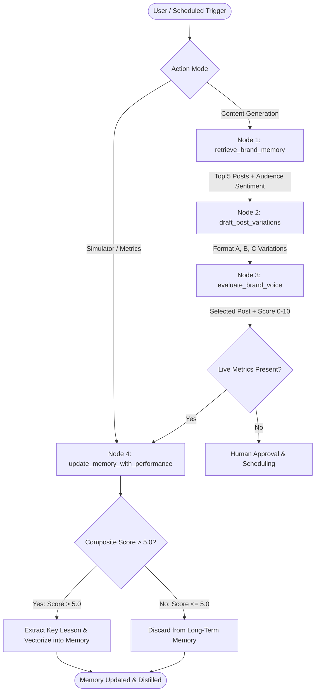

# SocioTrack: Social Media Engagement Agent

A production-grade, closed-loop Social Media Engagement Agent built with **Python 3**, **LangGraph**, **ChromaDB / Supabase pgvector**, **FastAPI**, and **Next.js 14**.

SocioTrack combines deterministic state machines with vector reinforcement learning to autonomously draft high-signal technical content, enforce brand voice guidelines, and learn from live post engagement metrics.

---

## Architecture Diagram



---

## Repository Structure & Team Ownership

```
social-engagement-agent/
├── .env.example                  # Centralized template for API keys & DB URLs
├── .gitignore
├── README.md                     # Run instructions & architecture diagram
│
├── backend/                      # Owned by Person 1 & Person 2
│   ├── app/
│   │   ├── __init__.py
│   │   ├── main.py               # FastAPI app entry point & CORS
│   │   ├── config.py             # Pydantic Settings (ENV loading)
│   │   ├── api/
│   │   │   ├── __init__.py
│   │   │   ├── routes_posts.py   # /api/generate-drafts, /api/posts/approve
│   │   │   ├── routes_memory.py  # /api/memory/insights
│   │   │   └── routes_sim.py     # /api/simulator/feed-metrics
│   │   ├── core/
│   │   │   ├── agent.py          # Person 1: LangGraph StateGraph definition
│   │   │   ├── memory.py         # Person 1: Vector search & scoring algorithm
│   │   │   └── prompts.py        # System prompts & voice constraints
│   │   ├── db/
│   │   │   ├── session.py        # SQLAlchemy / Supabase client connector
│   │   │   └── models.py         # SQLAlchemy ORM models matching SQL schema
│   │   └── schemas/
│   │       ├── post_schema.py    # Pydantic input/output contracts
│   │       └── memory_schema.py
│   ├── scripts/
│   │   ├── schema.sql            # Core Supabase DDL schema
│   │   └── seed_db.py            # Person 4 database population script
│   ├── tests/
│   │   ├── test_agent.py         # Person 1 standalone test
│   │   └── test_api.py           # Person 2 & 4 endpoint verification
│   ├── requirements.txt
│   └── Dockerfile
│
├── frontend/                     # Owned by Person 3
│   ├── src/
│   │   ├── app/
│   │   │   ├── layout.tsx
│   │   │   ├── page.tsx          # Main dashboard view
│   │   │   └── globals.css
│   │   ├── components/
│   │   │   ├── Navbar.tsx
│   │   │   ├── DraftQueue.tsx    # Center column: generated post cards
│   │   │   ├── MemoryDrawer.tsx  # Right column: learned audience insights
│   │   │   ├── SimulatorBar.tsx  # Bottom bar: metric injection controls
│   │   │   └── ui/               # shadcn components (button, card, dialog, etc.)
│   │   ├── lib/
│   │   │   ├── api.ts            # Client fetch wrappers pointing to backend
│   │   │   └── utils.ts
│   │   └── mocks/
│   │       └── mockData.ts       # Fallback JSON to unblock UI without backend
│   ├── public/
│   ├── package.json
│   ├── tailwind.config.js
│   └── tsconfig.json
│
└── presentation/                 # Owned by Person 4
    ├── pitch_deck.pdf            # Slide deck PDF
    ├── demo_script.md            # Hackathon pitch & timed demo walkthrough
    └── demo_recording_link.txt   # Video recording link & timestamps
```

---

## LangGraph 4-Node Agentic Core (Person 1)

1. **`retrieve_brand_memory`**:
   - Queries ChromaDB for the **top 5 past high-performing posts** closest to the topic.
   - Extracts live **audience sentiment signals** and historical lessons.
2. **`draft_post_variations`**:
   - Generates 3 distinct formats:
     - **Format A: Data-first**: Latency benchmarks, cost reductions, and hard metrics.
     - **Format B: Hot take**: Contrarian stance debunking market hype, grounded in practitioner realities.
     - **Format C: Tactical breakdown**: Step-by-step 4-step implementation playbooks.
3. **`evaluate_brand_voice`**:
   - Evaluates drafts against brand Dos and Don'ts.
   - Outputs a **0.0 - 10.0 match score** and selects the winning post.
4. **`update_memory_with_performance`**:
   - Computes composite viral score:
     $$\text{Composite Score} = \frac{(\text{Shares} \times 3) + (\text{Replies} \times 2) + (\text{Likes} \times 1)}{\text{Impressions}} \times 100$$
   - Gating rule: If $\text{Composite Score} > 5.0$, distills the key lesson and embeds it into ChromaDB vector memory.

---

## Quickstart Instructions

### Option A: One-Command Docker Compose (Recommended)

```bash
# Start backend, frontend, and database
docker-compose up --build
```
- Dashboard: `http://localhost:3000`
- API Docs: `http://localhost:8000/docs`

### Option B: Terminal / Local Development

#### 1. Backend Setup (FastAPI & Agent)

```bash
# 1. Create and activate virtual environment
python3 -m venv .venv
source .venv/bin/activate

# 2. Install dependencies
pip install -r backend/requirements.txt

# 3. Seed database, vector store, and 15 realistic posts (Person 4)
python backend/scripts/seed_db.py

# 4. Start FastAPI backend
uvicorn backend.app.main:app --reload --host 0.0.0.0 --port 8000
```
Interactive Swagger docs: `http://localhost:8000/docs`

#### 2. Frontend Setup (Next.js Dashboard)

```bash
cd frontend

# 1. Install frontend packages
npm install

# 2. Start Next.js development server
npm run dev
```
Dashboard will be live at `http://localhost:3000`.

---

### 📦 Seed Dataset (`seed_data.json`)
The repository includes a pre-populated dataset [`seed_data.json`](file:///Users/keerthanakeerz/hackathons/microsoft/seed_data.json) with:
- **5 High-Engagement Posts**: Contrarian technical hooks, code snippets/benchmarks, 14:00 UTC schedule, zero links.
- **5 Mediocre-Engagement Posts**: Generic announcements and links to blogs/webinars.
- **5 Poor-Engagement Posts**: Corporate jargon, buzzwords, and hashtag stuffing.
- **6 Structured Memory Items**: Empirical cognitive rules extracted from the high-performing posts.

---

## Running the Automated Test Suite

Run the Person 1 Agent Core tests and Person 2 & 4 API integration tests:

```bash
# Activate virtual environment
source .venv/bin/activate

# Run all test suites
python -m unittest backend/tests/test_agent.py backend/tests/test_api.py
```

All 10 unit and integration tests execute in < 1 second against an isolated in-memory vector store.
