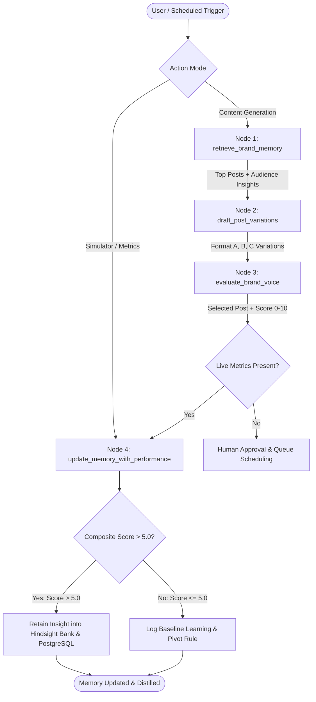

# SocioTrack: Social Media Engagement Agent

> **AI Social Media Engagement Agent with Persistent Memory**  
> Powered by [Hindsight](https://github.com/vectorize-io/hindsight) (Vectorize.io), LangGraph, FastAPI, and Next.js 14.

SocioTrack is an intelligent, closed-loop Social Media Engagement Agent that remembers, recalls, and improves over time. Unlike stateless bots that forget context across runs, SocioTrack learns which post styles, topics, hooks, and timing drive real engagement for each brand's specific audience.

---

## 🏗️ Architecture Diagram



---

## 👥 Team Ownership & Modules

### **Person 1 (Agent & LangGraph Core)**
* **LangGraph StateGraph (`backend/app/core/agent.py`)**: Deterministic agent cycle generating 3 format variations (Data-first, Contrarian, Tactical breakdown) with voice compliance scoring.
* **Vector Memory Integration (`backend/app/core/memory.py`)**: Semantic memory retrieval and audience sentiment signals.

### **Person 2 (Backend API & Database Layer)**
* **PostgreSQL Schema (`backend/db/schema.sql`)**: Full DDL schema with `pgvector` (`vector(1536)`), enums, and indexes:
  - `brands`: Brand identity, voice descriptions, target audience.
  - `posts`: Full post lifecycle (`draft` → `pending_approval` → `scheduled` → `published`).
  - `post_analytics`: Impressions, likes, replies, shares, and weighted engagement scores.
  - `agent_memories`: Learned audience rules and insights synchronized with Hindsight memory banks.
* **FastAPI REST API Layer (`backend/app/routers/`)**:
  - `POST /api/generate-drafts`: Ingests `{ brand_id, topic }`, triggers agent workflow with Hindsight memory recall.
  - `POST /api/posts/approve`: Accepts `{ post_id, approved_content, scheduled_time }`, schedules post.
  - `GET /api/posts/queue`: Returns all scheduled and pending posts chronologically.
  - `POST /api/simulator/feed-metrics`: Accepts engagement metrics, calculates weighted score, triggers memory feedback loop.
  - `GET /api/memory/insights?brand_id={id}`: Returns learned audience insights.
  - `GET /api/brands` & `POST /api/brands`: Brand persona management for frontend selectors.
* **Hindsight Memory Client (`backend/app/services/hindsight_client.py`)**: Official integration for retain, recall, reflect.
* **Seed Data & Tooling (`backend/db/seed.py` / `seed.sql`)**: Pre-populated mock data for immediate testing.
* **Test Suite (`backend/tests/`)**: Unit & integration test coverage via pytest.

---

## 🧠 Engagement Score Formula

$$\text{Engagements} = (\text{likes} \times 1.0) + (\text{replies} \times 2.5) + (\text{shares} \times 3.5)$$
$$\text{Engagement Score} = \left(\frac{\text{Engagements}}{\text{impressions}}\right) \times 100$$

---

## 🚀 Quick Start Instructions

### Option A: One-Command Docker Compose (Recommended)

```bash
# Start backend, frontend, and database
docker-compose up --build
```
- Dashboard: `http://localhost:3000`
- API Docs: `http://localhost:8000/docs`

### Option B: Local Development

#### 1. Backend Setup (FastAPI & Agent)

```bash
cd backend
python3 -m venv .venv
source .venv/bin/activate
pip install -r requirements.txt

# Seed database and agent memories
python db/seed.py

# Start FastAPI server
./run.sh
```
Interactive Swagger docs: 👉 **[http://localhost:8000/docs](http://localhost:8000/docs)**

#### 2. Frontend Setup (Next.js Dashboard)

```bash
cd frontend
npm install
npm run dev
```
Frontend UI: 👉 **[http://localhost:3000](http://localhost:3000)**

---

## 📦 Seed Dataset

The repository includes both Python and SQL seeders (`backend/db/seed.py`, `backend/db/seed.sql`, and `backend/scripts/seed_data.json`) featuring:
- **High-Engagement Posts**: Contrarian technical hooks, code snippets, benchmark percentages.
- **Mediocre & Low-Engagement Posts**: Generic corporate announcements.
- **Structured Memory Rules**: High-confidence cognitive rules retained in Hindsight memory banks.

---

## 🧪 Running Tests

```bash
PYTHONPATH=backend pytest backend/tests
```

---

## 📡 REST API Reference

### 1. Generate Drafts
```bash
curl -X POST http://localhost:8000/api/generate-drafts \
  -H "Content-Type: application/json" \
  -d '{
    "brand_id": "a1b2c3d4-e5f6-7a8b-9c0d-1e2f3a4b5c6d",
    "topic": "Agent Memory Architecture"
  }'
```

### 2. Approve and Schedule Post
```bash
curl -X POST http://localhost:8000/api/posts/approve \
  -H "Content-Type: application/json" \
  -d '{
    "post_id": "f6a7b89c-0d1e-2f3a-4b5c-6d7e8f901234",
    "approved_content": "Approved post content ready for publishing.",
    "scheduled_time": "2026-11-08T15:00:00Z"
  }'
```

### 3. Get Post Queue
```bash
curl -X GET http://localhost:8000/api/posts/queue
```

### 4. Simulate Metrics & Trigger Feedback Loop
```bash
curl -X POST http://localhost:8000/api/simulator/feed-metrics \
  -H "Content-Type: application/json" \
  -d '{
    "post_id": "c3d4e5f6-a7b8-9c0d-1e2f-3a4b5c6d7e8f",
    "impressions": 15000,
    "likes": 520,
    "replies": 95,
    "shares": 80
  }'
```

### 5. Get Learned Brand Insights
```bash
curl -X GET "http://localhost:8000/api/memory/insights?brand_id=a1b2c3d4-e5f6-7a8b-9c0d-1e2f3a4b5c6d"
```
